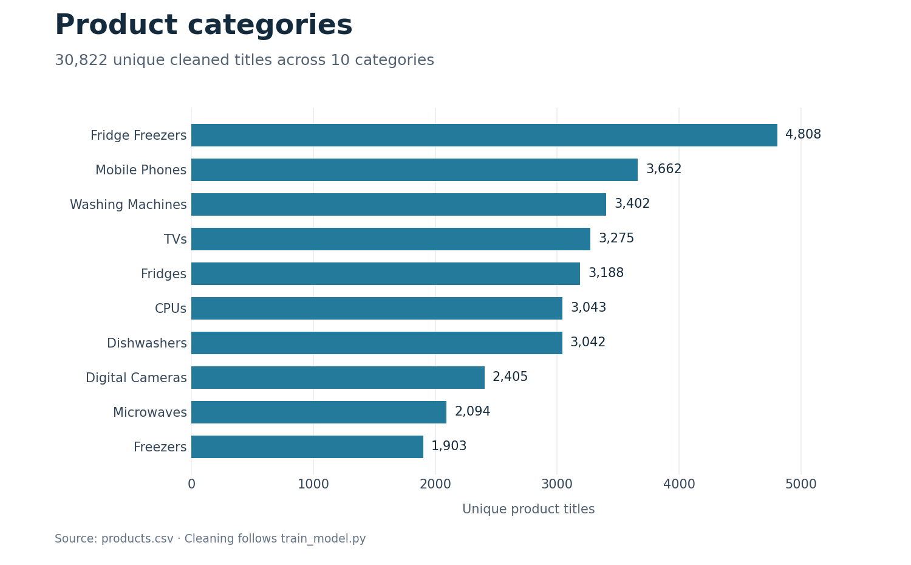

# Product Category Classifier

A Python project that assigns product titles to **10 catalog categories** using word and character TF-IDF, a Linear SVC classifier, and lookup rules for known product model codes.

**Author:** Igor Jovanovic

## What it demonstrates

Product categorization can help organize catalog imports and reduce manual sorting. This educational project demonstrates data cleaning, text feature engineering, model evaluation, model persistence, and an interactive prediction tool.

The notebook records **98.88% test accuracy** for the word + character + numeric Linear SVC experiment. The exported model is subsequently trained on the full cleaned dataset; the notebook score describes the held-out experiment rather than a separate evaluation of that exported artifact.

## Data

The supplied `products.csv` contains **35,311 rows and 8 columns**. Training uses the product title and category label.

Cleaning trims column names and text, standardizes three category labels, removes missing or empty titles, removes titles assigned to conflicting categories, and keeps one row per remaining title. This leaves **30,822 product titles** across:

CPUs, Digital Cameras, Dishwashers, Freezers, Fridge Freezers, Fridges, Microwaves, Mobile Phones, TVs, and Washing Machines.



## How prediction works

| Component | Implementation |
|---|---|
| Word features | TF-IDF unigrams and bigrams; up to 30,000 features |
| Character features | Character TF-IDF n-grams of length 3–5; up to 30,000 features |
| Numeric features | Title length, word count, digit count, special-character count, longest-word length |
| Classifier | Linear SVC using the combined sparse features |
| Known model codes | Category lookup before falling back to the classifier |

The final training script fits the vectorizers, scaler, and classifier on all cleaned rows. It retains a model-code rule only when the code occurs at least twice and every occurrence has the same category. The model bundle contains the fitted components and these rules.

## Recorded evaluation

The notebook uses a **stratified 80/20 split** with `random_state=42`: 24,657 training rows and 6,165 test rows. Vectorizers and numeric scaling are fitted on the training partition.

| Notebook experiment | Test accuracy | Macro F1 | Weighted F1 |
|---|---:|---:|---:|
| Linear SVC: word + character + numeric features | **98.88%** | **0.9889** | **0.9888** |
| Hybrid: training-only model-code lookup + Linear SVC | 98.85% | 0.9885 | 0.9885 |

The hybrid experiment uses an 80% category-consensus threshold for lookup rules, while the exported training script uses 100%. It improves some hand-picked examples but does not improve aggregate test accuracy. Some notebook SVC experiments also report convergence warnings; the final training script raises `max_iter` to 10,000.

These are saved notebook results, also transcribed in [notebook_results.csv](docs/notebook_results.csv). Similar product model codes can appear on both sides of the random split, so this evaluation does not establish performance on entirely unseen model codes or a different catalog.

## Run locally

Python 3.12 was used to verify the committed model. `requirements.txt` pins scikit-learn to **1.9.0**, matching the saved artifact.

```bash
git clone https://github.com/IgorJovanovic3/IMLP6-Task3-Product-Category-Classifier.git
cd IMLP6-Task3-Product-Category-Classifier
python -m venv .venv
```

Activate the environment:

- Windows PowerShell: `.\.venv\Scripts\Activate.ps1`
- macOS/Linux: `source .venv/bin/activate`

Then install dependencies and start the interactive predictor from the repository root:

```bash
python -m pip install -r requirements.txt
python predict_category.py
```

Enter a product title when prompted; type `exit` to stop. The current terminal prompts are in Serbian.

Examples verified with the committed model:

| Product title | Predicted category | Method |
|---|---|---|
| `iphone 7 32gb gold` | Mobile Phones | Linear SVC |
| `bosch wap28390gb 8kg 1400 spin` | Washing Machines | Model-code lookup |
| `smeg sbs8004po` | Fridge Freezers | Model-code lookup |

## Retrain and explore

```bash
python train_model.py
jupyter notebook product_classifier_analysis.ipynb
```

Training overwrites `product_category_model.pkl`. The notebook contains exploratory analysis, feature comparisons, evaluation, and example predictions.

| File | Purpose |
|---|---|
| `products.csv` | Input dataset |
| `product_classifier_analysis.ipynb` | Analysis and recorded experiments |
| `train_model.py` | Full-data training and bundle export |
| `predict_category.py` | Interactive command-line prediction |
| `product_category_model.pkl` | Saved classifier, feature transformers, and lookup rules |
| `docs/create_figures.py` | Recreates the category-distribution chart |

## Limitations and next steps

The tool always chooses one of its ten known categories; it does not reject an unfamiliar product type. Closely related appliances can be confused. A next evaluation should hold out entire product model codes and test a separate catalog before integrating the classifier into an import workflow.
